# TVMaze App — The Complete Lecture Guide

> A TV show discovery app built with **Flutter** + **BLoC**, using the free **TVMaze API**.
> This README is written as a **lecture**: it starts from the basics and ends with you
> understanding every file, every widget, every event and every state in this project.

---

## Table of Contents

| # | Lecture | What you will learn |
|---|---|---|
| 0 | [Setup & Run](#lecture-0--setup--run) | How to run the app and the tests |
| 1 | [Flutter Basics You Need](#lecture-1--flutter-basics-you-need) | Widget, State, BuildContext, Future, async/await, JSON |
| 2 | [The Big Picture (Architecture)](#lecture-2--the-big-picture-architecture) | data / domain / presentation layers, folder structure |
| 3 | [How the App Starts](#lecture-3--how-the-app-starts) | `main.dart`, `app.dart`, providers |
| 4 | [The Core Folder](#lecture-4--the-core-folder) | API client, errors, Show entity/model, theme, shared widgets |
| 5 | [BLoC From Zero](#lecture-5--bloc-from-zero) | Event, State, Bloc, emit, BlocBuilder, context.read |
| 6 | [Feature: Home + Pagination](#lecture-6--feature-home--pagination) | Loading pages of shows |
| 7 | [Feature: Search + Debounce](#lecture-7--feature-search--debounce) | Waiting for the user to stop typing |
| 8 | [Feature: Show Details](#lecture-8--feature-show-details) | 3 API calls at once, tabs, seasons |
| 9 | [Feature: Watchlist + Local Storage](#lecture-9--feature-watchlist--local-storage) | SharedPreferences, saving JSON |
| 10 | [Navigation & Profile](#lecture-10--navigation--profile) | Bottom nav bar, IndexedStack, routes |
| 11 | [UI Decoded — Widget Trees](#lecture-11--ui-decoded--widget-trees) | Every screen broken into widgets |
| 12 | [One Full Journey](#lecture-12--one-full-journey-end-to-end) | Tap → event → API → state → UI |
| 13 | [Error Handling & Edge Cases](#lecture-13--error-handling--edge-cases) | What happens when things go wrong |
| 14 | [Tests](#lecture-14--tests) | How the tests work |
| 15 | [Viva / Exam Q&A](#lecture-15--viva--exam-qa) | Questions you will likely be asked |
| 16 | [Glossary](#lecture-16--glossary) | All terms in one place |

---

# Lecture 0 — Setup & Run

```bash
flutter pub get          # download packages
flutter run              # run on phone / emulator
flutter run -d chrome    # run in Chrome
flutter test             # run the unit tests
flutter analyze          # check the code for problems
```

> **Windows desktop note:** if the project is on an **exFAT** drive, `flutter run -d windows`
> fails with a *symlink* error. exFAT drives cannot create symlinks. Use Chrome or an Android phone,
> or move the project to an NTFS drive (like `C:`) and turn on Windows **Developer Mode**.

### Packages used (`pubspec.yaml`)

| Package | Why we need it | Where it is used |
|---|---|---|
| `flutter_bloc` | State management (BLoC pattern) | every `bloc/` folder, every screen |
| `equatable` | Compare objects by their values | every event, state, entity |
| `http` | Send GET requests to the API | `core/network/api_client.dart` |
| `shared_preferences` | Save small data on the phone | `watchlist_local_data_source.dart` |
| `rxdart` | `debounceTime` + `switchMap` for search | `search_bloc.dart` |
| `bloc_test` (dev) | `blocTest()` to test BLoCs | `test/features/*/presentation/bloc/` |

### Screenshots

| Home | Search | Details – Overview | Details – Episodes |
|------|--------|--------------------|--------------------|
| 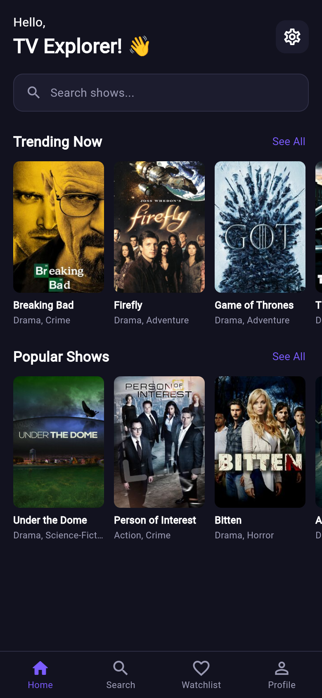 | 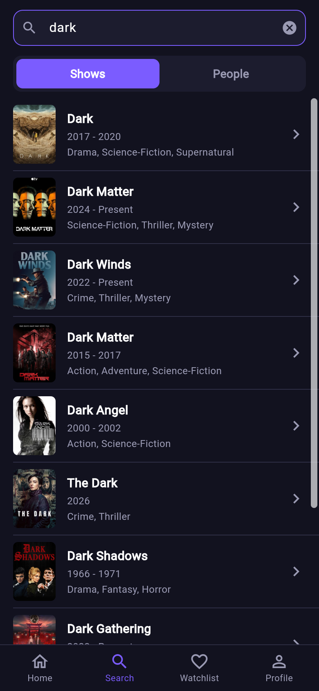 | 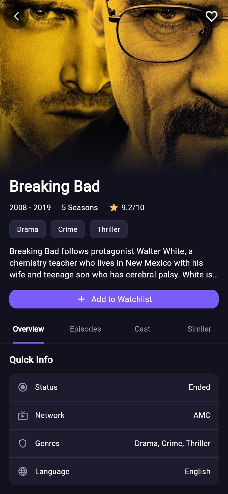 | 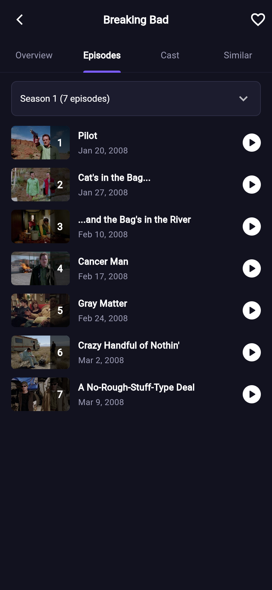 |

| Details – Cast | Watchlist | Profile |
|----------------|-----------|---------|
| 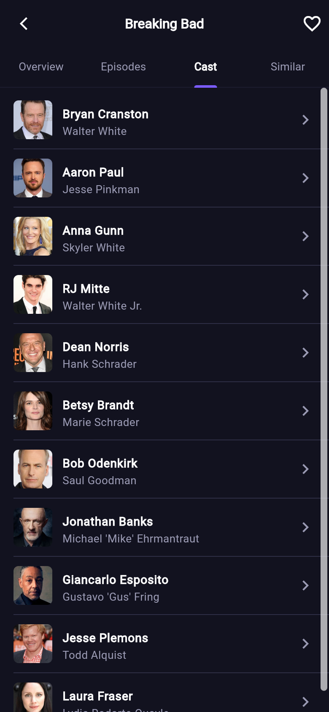 | 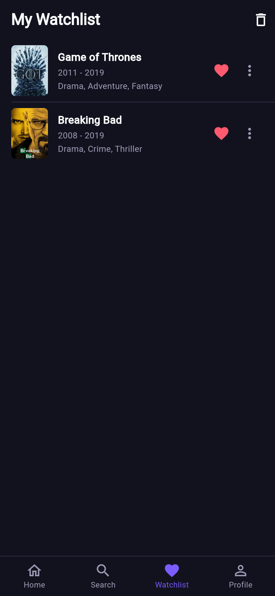 | 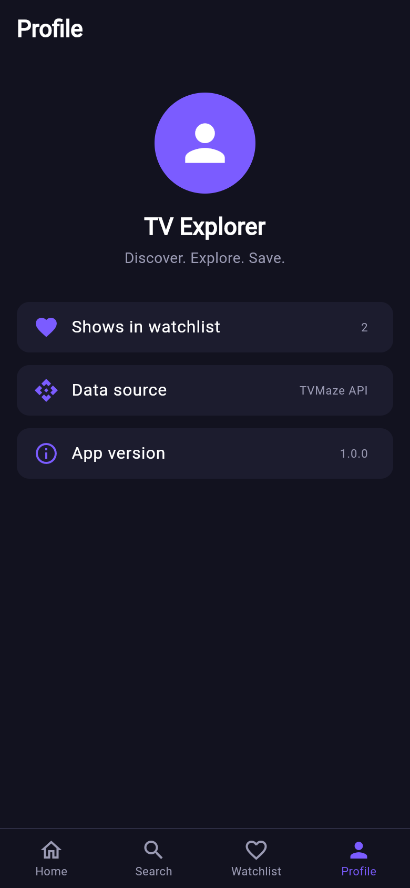 |

---

# Lecture 1 — Flutter Basics You Need

Before we look at the app, here are the 8 ideas the whole codebase is built on.

### 1.1 Everything is a Widget
A **widget** is a description of a piece of UI: a text, a button, a padding, a whole screen.
Widgets are put inside other widgets, making a **widget tree**.

```dart
Padding(                       // parent
  padding: EdgeInsets.all(16),
  child: Text('Hello'),        // child
)
```

### 1.2 StatelessWidget vs StatefulWidget

| | StatelessWidget | StatefulWidget |
|---|---|---|
| Has changing data inside? | No | Yes (in a `State` class) |
| How to redraw? | Parent gives new data | Call `setState(() {...})` |
| Example in this app | `ShowCard`, `GenreChip`, `EmptyView` | `SearchScreen` (text controller), `MainScreen` (selected tab) |

> **Tip:** In this app, **almost all data lives in BLoCs**, not in `setState`. We use `setState` only
> for tiny UI things (which tab is selected, show/hide the X button).

### 1.3 `build()` and `BuildContext`
- `build(BuildContext context)` returns the widget tree. Flutter calls it whenever it needs to redraw.
- `context` = "where am I in the tree". We use it to find things **above** us:
  `Theme.of(context)`, `Navigator.of(context)`, `context.read<HomeBloc>()`.

### 1.4 `Future`, `async`, `await`
Calling the internet takes time. A `Future<T>` is a value of type `T` that **will arrive later**.

```dart
Future<List<Show>> getShows(int page) async {
  final data = await apiClient.get(url);   // wait here, the app does NOT freeze
  return ...;
}
```

### 1.5 `try` / `catch`
Code that may fail goes into `try`. If an error is thrown, `catch` runs instead of crashing.

### 1.6 JSON
The API sends text like this:
```json
{ "id": 82, "name": "Game of Thrones", "rating": { "average": 8.9 } }
```
`jsonDecode` turns it into a Dart `Map<String, dynamic>`. Then we read `json['name']`.

### 1.7 Streams
A **Stream** is a pipe that delivers many values over time (a Future delivers one).
A BLoC **is** a stream of states: the UI listens and redraws every time a new state comes out.

### 1.8 Immutable objects & `copyWith`
Our states are **immutable** (all fields `final`). To change something we create a **new copy**:
```dart
emit(currentState.copyWith(isLoadingMore: true));
```

---

# Lecture 2 — The Big Picture (Architecture)

### 2.1 Three layers

The app is split into **3 layers**. Each layer has one job, and each one talks only to the
layer next to it.

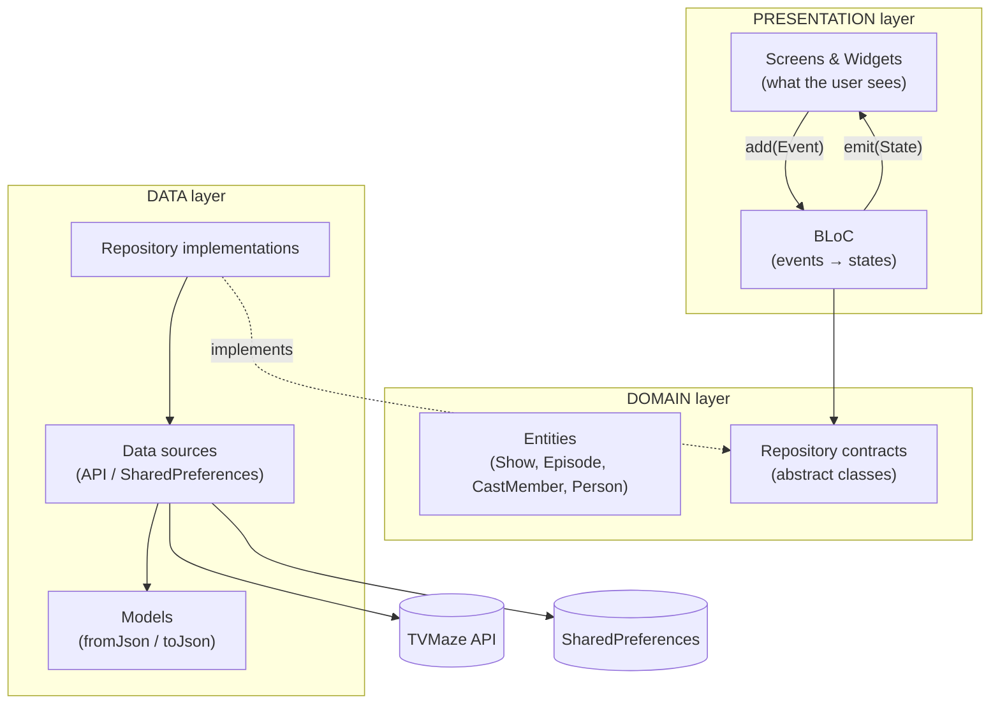

| Layer | Folder | Job | Knows about Flutter UI? | Knows about http? |
|---|---|---|---|---|
| **Presentation** | `presentation/` | Show UI, react to taps, hold state with BLoC | Yes | No |
| **Domain** | `domain/` | Define *what* data looks like and *what* we can ask for | No | No |
| **Data** | `data/` | Actually fetch / save data, convert JSON | No | Yes |

> **Why split like this?** If tomorrow we change from `http` to another package, or from
> SharedPreferences to a database, **only the data layer changes**. The BLoC and UI don't care,
> because they only talk to the abstract **repository**.

### 2.2 The request chain (one sentence)

> **Screen** adds an **Event** → **BLoC** calls the **Repository** → Repository calls the
> **DataSource** → DataSource calls the **ApiClient** → JSON becomes a **Model** → goes back up →
> BLoC **emits a State** → **BlocBuilder** redraws the Screen.

### 2.3 Full folder structure (every file explained)

```
lib/
├── main.dart ............................ App entry point. Loads SharedPreferences, runs the app.
│
├── app/
│   ├── app.dart ......................... Creates all repositories + app-wide BLoCs. Builds MaterialApp.
│   ├── app_router.dart .................. "/" → MainScreen, any other URL → NotFoundScreen (404).
│   └── main_screen.dart ................. Bottom navigation bar with 4 tabs (IndexedStack).
│
├── core/ ................................ Code SHARED by all features
│   ├── constants/
│   │   └── api_constants.dart ........... All API URLs in one place.
│   ├── network/
│   │   ├── api_client.dart .............. Sends GET requests, decodes JSON, converts errors.
│   │   └── api_exception.dart ........... Our own error class with a friendly message.
│   ├── entities/
│   │   └── show.dart .................... Show ENTITY (plain data, no JSON).
│   ├── models/
│   │   └── show_model.dart .............. ShowModel = Show + fromJson + toJson.
│   ├── theme/
│   │   ├── app_colors.dart .............. All colors.
│   │   └── app_theme.dart ............... ThemeData (dark theme, buttons, inputs, tabs).
│   ├── utils/
│   │   └── text_utils.dart .............. Remove HTML tags, format dates.
│   └── widgets/ ......................... Reusable widgets
│       ├── poster_image.dart ............ Network image with placeholder.
│       ├── loading_view.dart ............ Spinner (loading state).
│       ├── error_view.dart .............. Message + "Try Again" (error state).
│       ├── empty_view.dart .............. Icon + title + message (empty state).
│       ├── genre_chip.dart .............. Small "Drama" label.
│       └── show_list_tile.dart .......... Row: poster + title + years + genres.
│
└── features/
    ├── home/ ............................ FEATURE 1: show list + pagination
    │   ├── data/datasources/home_remote_data_source.dart
    │   ├── data/repositories/home_repository_impl.dart
    │   ├── domain/repositories/home_repository.dart
    │   └── presentation/
    │       ├── bloc/ home_bloc.dart, home_event.dart, home_state.dart
    │       ├── screens/ home_screen.dart, all_shows_screen.dart
    │       └── widgets/ show_card.dart, horizontal_show_list.dart, section_title.dart
    │
    ├── search/ .......................... FEATURE 2: search shows & people (debounce)
    │   ├── data/datasources/search_remote_data_source.dart
    │   ├── data/models/person_model.dart
    │   ├── data/repositories/search_repository_impl.dart
    │   ├── domain/entities/person.dart
    │   ├── domain/repositories/search_repository.dart
    │   └── presentation/
    │       ├── bloc/ search_bloc.dart, search_event.dart, search_state.dart
    │       ├── screens/ search_screen.dart
    │       └── widgets/ search_tabs.dart, person_tile.dart
    │
    ├── show_details/ .................... FEATURE 3: details, cast, episodes, similar
    │   ├── data/datasources/show_details_remote_data_source.dart
    │   ├── data/models/ cast_member_model.dart, episode_model.dart
    │   ├── data/repositories/show_details_repository_impl.dart
    │   ├── domain/entities/ cast_member.dart, episode.dart
    │   ├── domain/repositories/show_details_repository.dart
    │   └── presentation/
    │       ├── bloc/ show_details_bloc.dart, show_details_event.dart, show_details_state.dart
    │       ├── screens/ show_details_screen.dart
    │       └── widgets/ details_header.dart, overview_tab.dart, episodes_tab.dart,
    │                    cast_tab.dart, similar_tab.dart, watchlist_button.dart
    │
    ├── watchlist/ ....................... FEATURE 4: saved shows (SharedPreferences)
    │   ├── data/datasources/watchlist_local_data_source.dart
    │   ├── data/repositories/watchlist_repository_impl.dart
    │   ├── domain/repositories/watchlist_repository.dart
    │   └── presentation/
    │       ├── bloc/ watchlist_bloc.dart, watchlist_event.dart, watchlist_state.dart
    │       ├── screens/ watchlist_screen.dart
    │       └── widgets/ empty_watchlist.dart
    │
    ├── not_found/ ....................... 404 page for unknown URLs
    │   └── presentation/screens/not_found_screen.dart
    │
    └── profile/ ......................... Simple profile tab (UI only)
        └── presentation/screens/profile_screen.dart
```

### 2.4 API endpoints

| Feature | Endpoint | Used in |
|---|---|---|
| Get TV Shows | `GET /shows?page=0` | `HomeRemoteDataSource.getShows` |
| Load More Shows | `GET /shows?page=1` | `HomeRemoteDataSource.getShows` |
| Search Shows | `GET /search/shows?q=dark` | `SearchRemoteDataSource.searchShows` |
| Search People *(extra, People tab)* | `GET /search/people?q=bryan` | `SearchRemoteDataSource.searchPeople` |
| Show Details | `GET /shows/82` | `ShowDetailsRemoteDataSource.getShowDetails` |
| Show Cast | `GET /shows/82/cast` | `ShowDetailsRemoteDataSource.getCast` |
| Show Episodes | `GET /shows/82/episodes` | `ShowDetailsRemoteDataSource.getEpisodes` |

Base URL: `https://api.tvmaze.com`

---

# Lecture 3 — How the App Starts

### 3.1 `main.dart`

```dart
Future<void> main() async {
  WidgetsFlutterBinding.ensureInitialized();          // 1
  final prefs = await SharedPreferences.getInstance(); // 2
  final apiClient = ApiClient();                       // 3
  runApp(TvMazeApp(apiClient: apiClient, prefs: prefs)); // 4
}
```

1. **`ensureInitialized()`**: we use a plugin (SharedPreferences) *before* `runApp`, so Flutter
   must be ready first.
2. **Open local storage** once, at the start.
3. **Create one `ApiClient`** to be shared by all features.
4. **Start the app** with the root widget `TvMazeApp`.

### 3.2 `app.dart` — wiring everything together (Dependency Injection)

`TvMazeApp` builds 3 nested layers of providers:

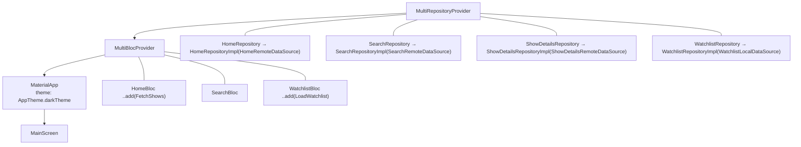

- **`RepositoryProvider<HomeRepository>`**: puts a repository into the widget tree.
  Note the type is the **abstract** `HomeRepository`, while the object is the **real**
  `HomeRepositoryImpl`. This is **dependency inversion**.
- **`BlocProvider`**: creates a BLoC and puts it into the tree. It also **closes** the BLoC
  automatically when it's removed.
- **`..add(FetchShows())`**: the `..` (cascade) means "create the bloc, **then** call `add` on it,
  and still return the bloc". So the shows start loading as soon as the app opens.
- Any widget **below** can now write `context.read<HomeBloc>()` or `context.read<HomeRepository>()`.

> **Why is `ShowDetailsBloc` not here?** Each details page needs its **own** BLoC (different show),
> so it is created inside `ShowDetailsScreen`. `Home`, `Search` and `Watchlist` live for the whole
> app, so they are created once at the top.

### 3.3 Startup sequence

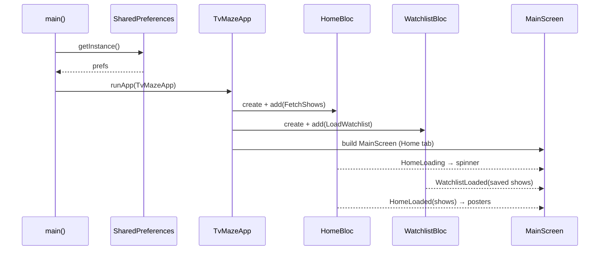

---

# Lecture 4 — The Core Folder

`core/` holds things that **every feature** uses.

### 4.1 `api_constants.dart` — all URLs in one place

```dart
static String shows(int page) => '$baseUrl/shows?page=$page';
static String searchShows(String query) =>
    '$baseUrl/search/shows?q=${Uri.encodeQueryComponent(query)}';
```
- These are **functions**, because the URL depends on a value (page, query, id).
- `Uri.encodeQueryComponent` makes text safe for a URL (`"game of"` → `"game+of"`).

### 4.2 `api_client.dart` — the only class that touches `http`

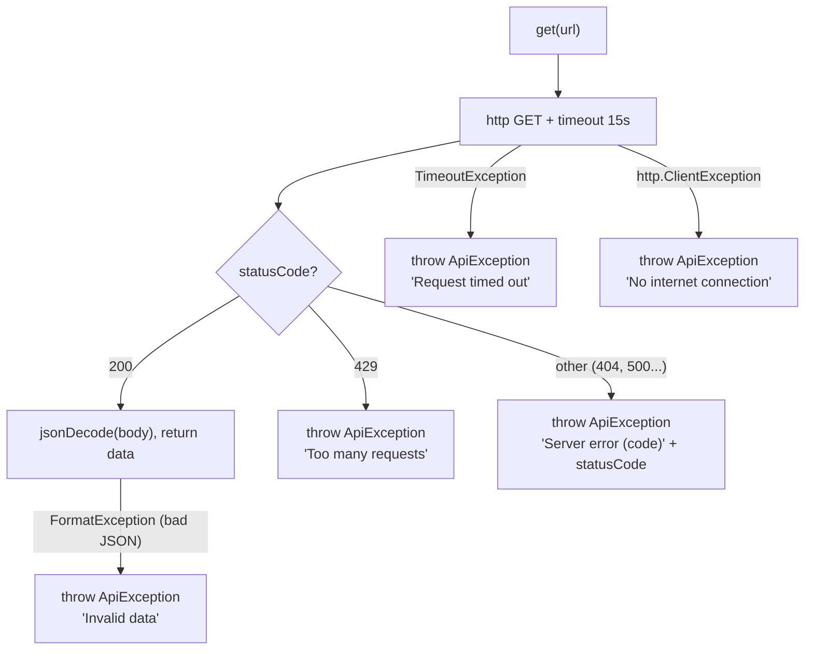

**Key idea:** whatever goes wrong, the rest of the app only ever sees **one** error type:
`ApiException`, which always carries a **friendly message**.

### 4.3 `api_exception.dart`

```dart
class ApiException implements Exception {
  final String message;
  final int? statusCode;          // e.g. 404 — used by pagination
  static String messageFrom(Object error) { ... }
}
```
- `messageFrom(error)`: if the error is an `ApiException`, return its message; otherwise return
  *"Something went wrong."* Every BLoC uses it in its `catch`.

### 4.4 Entity vs Model — `show.dart` and `show_model.dart`

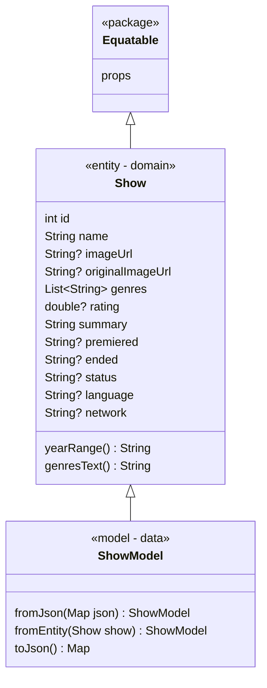

| | `Show` (entity) | `ShowModel` (model) |
|---|---|---|
| Lives in | `core/entities` (domain) | `core/models` (data) |
| Knows JSON? | No | Yes: `fromJson`, `toJson` |
| Used by | BLoCs, widgets | Data sources |

Because `ShowModel extends Show`, a `List<ShowModel>` **is also** a `List<Show>`. The data source
returns models, and the BLoC sees them as plain shows.

**`fromJson` handles missing data safely:**
```dart
final image = json['image'] as Map<String, dynamic>?;   // may be null
imageUrl: image?['medium'] as String?,                   // ?. = "only if not null"
name: json['name'] as String? ?? 'Unknown show',         // ?? = "or use this default"
network: (network?['name'] ?? webChannel?['name']) as String?, // Netflix shows use webChannel
summary: TextUtils.stripHtml(json['summary'] as String?),  // "<p>..</p>" → plain text
```

**Getters in `Show`:**
- `yearRange` → `"2008 - 2013"`, or `"2019 - Present"` if still running, or `"Unknown year"`.
- `genresText` → `"Drama, Crime, Thriller"`.
- `props => [id]`: thanks to **Equatable**, two shows are equal if they have the **same id**.

**`toJson`** writes the **same shape** as the API, so the saved watchlist can be read back with
the same `fromJson`: one parser for both.

### 4.5 `text_utils.dart`
- `stripHtml("<p><b>Dark</b> is...</p>")` → `"Dark is..."` (uses a RegExp `<[^>]*>`).
- `formatDate("2008-01-20")` → `"Jan 20, 2008"`.

### 4.6 Theme — `app_colors.dart`, `app_theme.dart`

| Color | Hex | Used for |
|---|---|---|
| `background` | `#12121F` | Screen background |
| `surface` | `#1C1C2E` | Cards, inputs, nav |
| `card` | `#26263B` | Chips, placeholders |
| `border` | `#2E2E45` | Outlines & dividers |
| `primary` | `#7B5CFF` | Purple buttons, selected tab |
| `textSecondary` | `#9A9AB3` | Grey text |
| `star` / `heart` | yellow / red | Rating star, saved heart |

`AppTheme.darkTheme` sets the defaults **once** (button shape, input borders, tab colors, snackbar
style), so the widgets don't repeat styling.

### 4.7 Shared widgets (`core/widgets/`)

| Widget | Type | Inputs | What it does |
|---|---|---|---|
| `PosterImage` | Stateless | `imageUrl`, `width`, `height`, `borderRadius`, `placeholderIcon` | `ClipRRect` + `Image.network`. While loading → grey box (`loadingBuilder`). If URL is null or fails → icon placeholder (`errorBuilder`). **Never crashes on a missing image.** |
| `LoadingView` | Stateless | — | Centered purple `CircularProgressIndicator`. Used for **loading states**. |
| `ErrorView` | Stateless | `message`, `onRetry` | Wi-Fi-off icon, message, **Try Again** button that calls `onRetry` (which adds the event again). Used for **error states**. |
| `EmptyView` | Stateless | `icon`, `title`, `message`, optional button | Purple circle icon + texts. Used for **empty states**. |
| `GenreChip` | Stateless | `label` | Rounded outlined box with text. |
| `ShowListTile` | Stateless | `show`, `onTap`, optional `trailing` | `InkWell` → `Row[PosterImage, Column[name, years, genres], trailing or chevron]`. Reused in Search, Similar, Watchlist. |

> **Tip:** Passing **callbacks** (`onRetry`, `onTap`) keeps these widgets **reusable**: the widget does not
> know *what* happens, the parent decides.

---

# Lecture 5 — BLoC From Zero

### 5.1 The problem BLoC solves
Without BLoC, a screen would do everything: call the API, store results, handle errors and
build the UI. That gets messy fast. **BLoC (Business Logic Component)** moves the logic out of the UI.

### 5.2 The 3 pieces

| Piece | Meaning | Analogy |
|---|---|---|
| **Event** | Something that **happened** ("user scrolled to bottom") | Your **order** |
| **BLoC** | Receives events, does work, outputs states | The **kitchen** |
| **State** | What the UI should show **right now** | The **food** you receive |

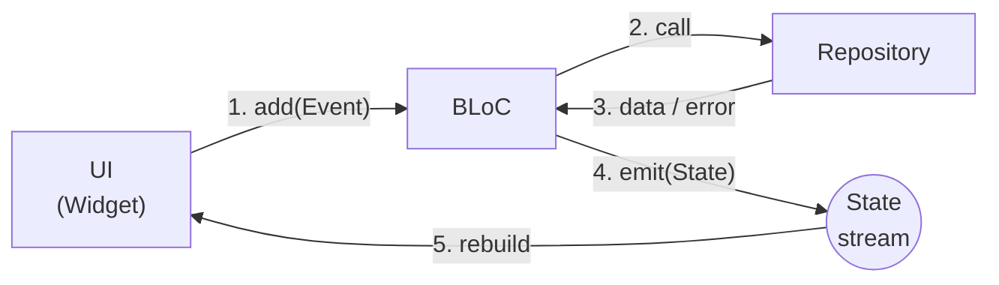

### 5.3 Anatomy of a BLoC (real code from `home_bloc.dart`)

```dart
class HomeBloc extends Bloc<HomeEvent, HomeState> {   // <EventType, StateType>
  final HomeRepository repository;                    // dependency (injected)

  HomeBloc({required this.repository}) : super(const HomeInitial()) { // first state
    on<FetchShows>(_onFetchShows);         // "when FetchShows arrives, run _onFetchShows"
    on<FetchMoreShows>(_onFetchMoreShows);
  }

  Future<void> _onFetchShows(FetchShows event, Emitter<HomeState> emit) async {
    emit(const HomeLoading());                   // UI shows spinner
    try {
      final shows = await repository.getShows(0);
      emit(HomeLoaded(shows: shows, currentPage: 0, hasReachedEnd: shows.isEmpty));
    } catch (error) {
      emit(HomeError(ApiException.messageFrom(error)));  // UI shows ErrorView
    }
  }
}
```

| Code | Meaning |
|---|---|
| `Bloc<HomeEvent, HomeState>` | This BLoC accepts `HomeEvent`s and outputs `HomeState`s |
| `super(const HomeInitial())` | The very first state |
| `on<FetchShows>(handler)` | Register a handler for one event type |
| `emit(state)` | Send a new state to the UI |
| `state` | The current state (read it inside handlers) |

### 5.4 Events & states are classes with a common parent
```dart
abstract class HomeEvent extends Equatable { ... }   // parent
class FetchShows extends HomeEvent { ... }           // child
class FetchMoreShows extends HomeEvent { ... }       // child
```
The UI checks the type with `is`:
```dart
if (state is HomeLoaded) { ... state.shows ... }   // Dart "promotes" state to HomeLoaded
```

### 5.5 Why `Equatable`?
BLoC **does not rebuild the UI if the new state equals the old one**. Normally two objects are
equal only if they are the *same object in memory*. `Equatable` compares **values** listed in `props`:
```dart
@override
List<Object?> get props => [shows, currentPage, hasReachedEnd, isLoadingMore, loadMoreFailed];
```

### 5.6 Using a BLoC in the UI — the 4 tools

| Tool | What it does | Example in this app |
|---|---|---|
| `BlocProvider(create: ...)` | Creates the BLoC and puts it in the tree | `app.dart`, `ShowDetailsScreen` |
| `BlocBuilder<B, S>(builder: ...)` | **Rebuilds** its child every time a new state is emitted | every screen |
| `context.read<B>()` | Gets the BLoC **once** (no rebuild). Use in `onPressed`, `onTap` | `context.read<HomeBloc>().add(const FetchShows())` |
| `bloc.add(Event)` | Sends an event | everywhere a user acts |

> **Rule:** use `context.read` inside **callbacks** (button presses). Use `BlocBuilder` to
> **draw** UI from the state.

### 5.7 The standard pattern every screen uses
```dart
BlocBuilder<HomeBloc, HomeState>(
  builder: (context, state) {
    if (state is HomeError)  return ErrorView(...);       // error
    if (state is HomeLoaded) {
      if (state.shows.isEmpty) return EmptyView(...);    // empty
      return _buildContent(...);                          // success
    }
    return const LoadingView();                           // loading / initial
  },
)
```
This handles all **4 required states**: loading, success, empty and error.

### 5.8 All BLoCs at a glance

| BLoC | Created where | Lives how long | Events | States |
|---|---|---|---|---|
| `HomeBloc` | `app.dart` | Whole app | `FetchShows`, `FetchMoreShows` | `HomeInitial`, `HomeLoading`, `HomeLoaded`, `HomeError` |
| `SearchBloc` | `app.dart` | Whole app | `SearchQueryChanged`, `SearchCategoryChanged` | `SearchInitial`, `SearchLoading`, `SearchLoaded`, `PeopleLoaded`, `SearchEmpty`, `SearchError` |
| `ShowDetailsBloc` | `ShowDetailsScreen` | One details page | `LoadShowDetails`, `SeasonSelected` | `ShowDetailsLoading`, `ShowDetailsLoaded`, `ShowDetailsError` |
| `WatchlistBloc` | `app.dart` | Whole app | `LoadWatchlist`, `AddToWatchlist`, `RemoveFromWatchlist`, `ClearWatchlist` | `WatchlistLoading`, `WatchlistLoaded`, `WatchlistError` |

---

# Lecture 6 — Feature: Home + Pagination

**Goal:** show TV shows, and load more pages when the user scrolls.

### 6.1 Data flow (bottom → top)

| File | Code | Job |
|---|---|---|
| `home_remote_data_source.dart` | `getShows(page)` | Calls `/shows?page=N`, maps each JSON to `ShowModel`. **If the API answers 404 → returns `[]`** (no more pages). |
| `home_repository.dart` | `abstract Future<List<Show>> getShows(int page)` | The contract |
| `home_repository_impl.dart` | `return remoteDataSource.getShows(page)` | Passes the call through |

```dart
} on ApiException catch (e) {
  if (e.statusCode == 404) return [];   // TVMaze: page doesn't exist = end of list
  rethrow;                              // any other error goes up to the BLoC
}
```

### 6.2 Events — `home_event.dart`

| Event | Fired by | Meaning |
|---|---|---|
| `FetchShows` | `app.dart` at start, pull-to-refresh, Try Again | Load page **0** from scratch |
| `FetchMoreShows` | Scrolling near the end (horizontal row or See All grid), retry button | Load the **next** page |

### 6.3 States — `home_state.dart`

| State | Fields | UI shows |
|---|---|---|
| `HomeInitial` | — | Spinner |
| `HomeLoading` | — | Spinner |
| `HomeLoaded` | `shows`, `currentPage`, `hasReachedEnd`, `isLoadingMore`, `loadMoreFailed` | Posters (+ small spinner / retry at the end) |
| `HomeError` | `message` | `ErrorView` with Try Again |

> **Tip:** `HomeLoaded` has **flags** instead of separate states for "loading more". We must **keep the
> old shows visible** while the next page loads. A separate `HomeLoading` would wipe the screen.

### 6.4 State diagram

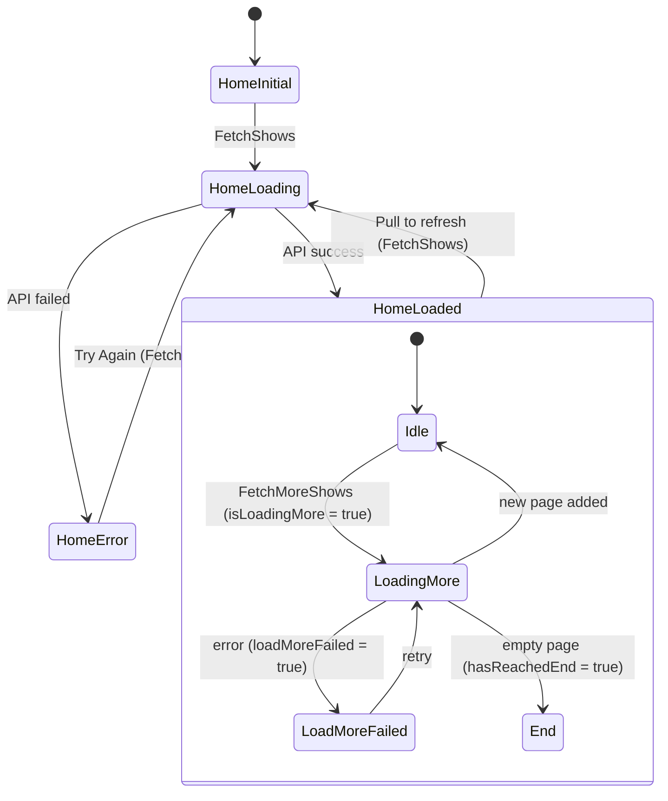

### 6.5 Pagination logic step by step (`_onFetchMoreShows`)

```dart
final currentState = state;
if (currentState is! HomeLoaded || currentState.isLoadingMore || currentState.hasReachedEnd) {
  return;                       // GUARD: ignore duplicate scroll events
}
emit(currentState.copyWith(isLoadingMore: true, loadMoreFailed: false));
try {
  final nextPage = currentState.currentPage + 1;
  final newShows = await repository.getShows(nextPage);
  emit(currentState.copyWith(
    shows: [...currentState.shows, ...newShows],   // old + new (spread operator)
    currentPage: nextPage,
    hasReachedEnd: newShows.isEmpty,
    isLoadingMore: false,
  ));
} catch (_) {
  emit(currentState.copyWith(isLoadingMore: false, loadMoreFailed: true));
}
```

**Why the guard?** The scroll listener fires **many times per second**. Without the guard we would
request page 2 ten times. Because `isLoadingMore` is set to `true` **before** the `await`, every
extra event is ignored.

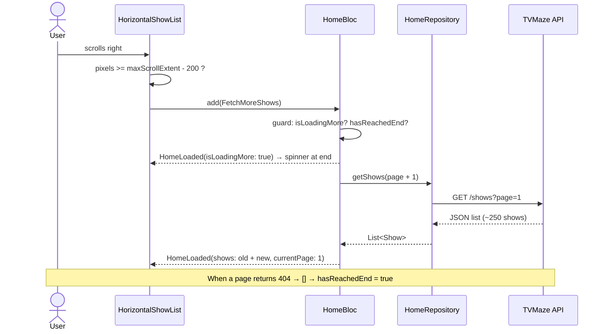

### 6.6 Home widgets

| Widget | File | Type | How it works |
|---|---|---|---|
| `HomeScreen` | `screens/home_screen.dart` | Stateless | `BlocBuilder<HomeBloc>` → error / empty / loading / content. Content is a `RefreshIndicator` around a `ListView` of: header, search bar, 2 sections. **Trending** = copy of the shows sorted by rating, first 10. Takes 2 callbacks: `onSearchTap` (go to Search tab) and `onSettingsTap` (go to Profile tab). |
| `_buildHeader` | inside HomeScreen | method | `Row[Column["Hello,", "TV Explorer!"], settings IconButton]` |
| `_buildSearchBar` | inside HomeScreen | method | Looks like a text field, but is a `GestureDetector` → `onSearchTap()`. |
| `SectionTitle` | `widgets/section_title.dart` | Stateless | `Row[title, "See All" TextButton]`. The button only shows if `onSeeAll` is given. |
| `HorizontalShowList` | `widgets/horizontal_show_list.dart` | **Stateful** (owns a `ScrollController`) | Horizontal `ListView.separated` of 110-px-wide `ShowCard`s. Its scroll listener calls `onEndReached` near the right end. Adds a spinner item when `isLoadingMore`. |
| `ShowCard` | `widgets/show_card.dart` | Stateless | `GestureDetector → Column[Expanded(PosterImage), name, first 2 genres]` |
| `AllShowsScreen` | `screens/all_shows_screen.dart` | **Stateful** (ScrollController) | Opened by **See All**. `CustomScrollView[SliverGrid (3 columns), bottom loader]`. Uses the **same HomeBloc**, so scrolling down sends `FetchMoreShows` and the grid grows. Bottom shows spinner / "Tap to retry" / "You've reached the end". |

> **Why does a ScrollController need a StatefulWidget?** A controller must be created once and
> **disposed** (`dispose()`) when the widget is removed, otherwise it leaks memory. `State` gives us
> `initState` and `dispose` for that.

---

# Lecture 7 — Feature: Search + Debounce

**Goal:** search shows (or people) by name while typing, **without** calling the API on every key press.

### 7.1 Data flow

| File | Code |
|---|---|
| `search_remote_data_source.dart` | `searchShows(q)` → `/search/shows?q=` → reads `item['show']`. `searchPeople(q)` → `/search/people?q=` → reads `item['person']`. |
| `person.dart` / `person_model.dart` | `Person(id, name, imageUrl, country, birthday)` + `fromJson` |
| `search_repository(_impl).dart` | contract + pass-through for both methods |

The search API wraps each result: `[{ "score": 0.89, "show": {...} }]`, so we take the inner object.

### 7.2 Events & states

| Event | Fired by | Debounced? |
|---|---|---|
| `SearchQueryChanged(query)` | every key press in the `TextField`, X button, Try Again | Yes, 500 ms |
| `SearchCategoryChanged(category)` | tapping **Shows** / **People** | No, instant |

`enum SearchCategory { shows, people }`: an **enum** is a fixed list of choices.

| State | When | UI |
|---|---|---|
| `SearchInitial` | Query is empty | "Search TV Shows" hint (EmptyView) |
| `SearchLoading` | Waiting for API | Spinner |
| `SearchLoaded(shows)` | Shows found | List of `ShowListTile` |
| `PeopleLoaded(people)` | People found | List of `PersonTile` |
| `SearchEmpty(query)` | API returned `[]` | "No results found for …" |
| `SearchError(message, query)` | API failed | ErrorView; Try Again re-sends the query |

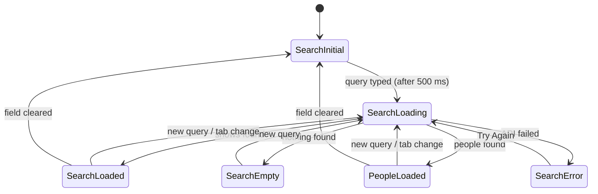

### 7.3 Debounce explained

```dart
EventTransformer<E> debounce<E>(Duration duration) {
  return (events, mapper) => events.debounceTime(duration).switchMap(mapper);
}

on<SearchQueryChanged>(_onQueryChanged,
    transformer: debounce(const Duration(milliseconds: 500)));
```

- **`debounceTime(500ms)`** (from rxdart): lets an event through only if **no newer event** came
  within 500 ms. Typing "dark" fast = 4 events → **1** API call.
- **`switchMap`**: if a new search starts while an old one is still running, the **old one is
  cancelled**. So old results never replace new ones.

```mermaid
gantt
    title User types "dark" (each letter = an event)
    dateFormat  X
    axisFormat %L ms
    section Key presses
    d      :0, 1
    a      :120, 121
    r      :250, 251
    k      :380, 381
    section Debounce timer (500 ms)
    timer resets on every key :0, 380
    waiting 500ms after "k" :380, 880
    section API call
    GET /search/shows?q=dark :880, 1100
```

Without debounce: 4 API calls (`d`, `da`, `dar`, `dark`). With debounce: **1** call.

### 7.4 One `_search()` for both events
The BLoC remembers `_query` and `_category` in private fields. Both handlers update one field,
then call the same `_search(emit)`:
```dart
if (_category == SearchCategory.shows) {
  final shows = await repository.searchShows(query);
  emit(shows.isEmpty ? SearchEmpty(query) : SearchLoaded(shows));
} else {
  final people = await repository.searchPeople(query);
  emit(people.isEmpty ? SearchEmpty(query) : PeopleLoaded(people));
}
```

### 7.5 Search widgets

| Widget | Type | How it works |
|---|---|---|
| `SearchScreen` | **Stateful** | Owns a `TextEditingController` (to read/clear the text) and `_category` (which tab looks selected). `onChanged` → `add(SearchQueryChanged)` + `setState` (only to show/hide the X). `_buildResults` turns each state into UI. |
| `SearchTabs` | Stateless | `Container[Row[tab "Shows", tab "People"]]`. The selected tab gets the purple background. Calls `onChanged(category)`. |
| `PersonTile` | Stateless | `Row[PosterImage, Column[name, "Country · Born 1956"]]`. Builds the details with a **collection-if** list: `[if (country != null) country, ...]`. |
| `ShowListTile` | (core) | Show result row, tap → details |

---

# Lecture 8 — Feature: Show Details

**Goal:** show the poster, title, summary, rating, genres, **cast**, **episodes grouped by season**,
similar shows, and a watchlist button.

### 8.1 Entities & models

| Entity | Fields | Model reads from JSON |
|---|---|---|
| `CastMember` | `personName`, `characterName`, `imageUrl` | `json['person']['name']`, `json['character']['name']`, `json['person']['image']['medium']` |
| `Episode` | `id`, `name`, `season`, `number?`, `airdate?`, `imageUrl?`, `summary` | same keys; summary HTML removed |

### 8.2 Events & states

| Event | Fired by |
|---|---|
| `LoadShowDetails(showId)` | `BlocProvider.create` when the page opens, Try Again |
| `SeasonSelected(season)` | Season dropdown in the Episodes tab |

| State | Fields / helpers |
|---|---|
| `ShowDetailsLoading` | — |
| `ShowDetailsLoaded` | `show`, `cast`, `episodes`, `selectedSeason`; getter **`seasons`**; method **`episodesOfSeason(n)`**; `copyWith(selectedSeason)` |
| `ShowDetailsError` | `message` |

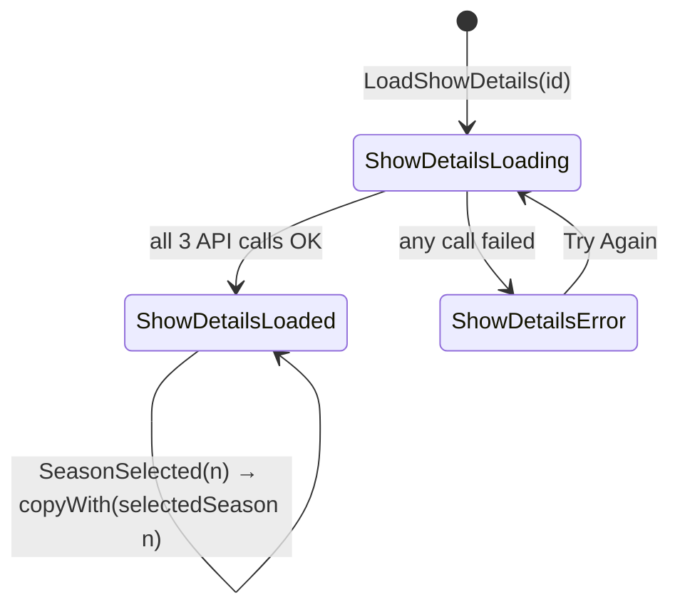

### 8.3 Three API calls at the same time — `Future.wait`

```dart
final results = await Future.wait([
  repository.getShowDetails(event.showId),   // /shows/82
  repository.getCast(event.showId),          // /shows/82/cast
  repository.getEpisodes(event.showId),      // /shows/82/episodes
]);
final show     = results[0] as Show;
final cast     = results[1] as List<CastMember>;
final episodes = results[2] as List<Episode>;
```

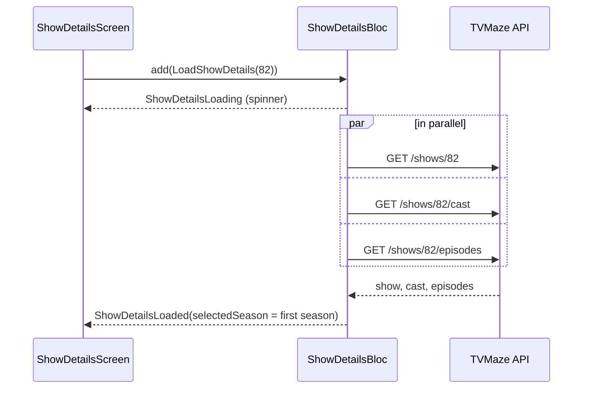

- **Parallel** = total time ≈ the slowest call, not the sum of all three.
- If **any** call fails, `Future.wait` throws → `catch` → `ShowDetailsError`.

### 8.4 "Episodes grouped by season" explained

```dart
List<int> get seasons {
  final seasonSet = episodes.map((e) => e.season).toSet(); // {1,1,1,2,2,...} → {1,2}
  return seasonSet.toList()..sort();                      // [1, 2, 3, 4, 5]
}
List<Episode> episodesOfSeason(int season) =>
    episodes.where((e) => e.season == season).toList();   // filter
```
- `.map` → transform each item, `.toSet()` → remove duplicates, `.where` → filter.
- The dropdown lists `seasons`. Choosing one → `SeasonSelected(n)` → BLoC emits a **copy** with the new
  `selectedSeason` → list redraws. **No new API call**, because all episodes are already loaded.
- The header's "5 Seasons" = `state.seasons.length`.

### 8.5 Two layouts (matching the design)

`_DetailsView` is a **StatefulWidget** with a `TabController` (4 tabs). Its listener calls
`setState` when the tab changes, and `build` picks a layout:

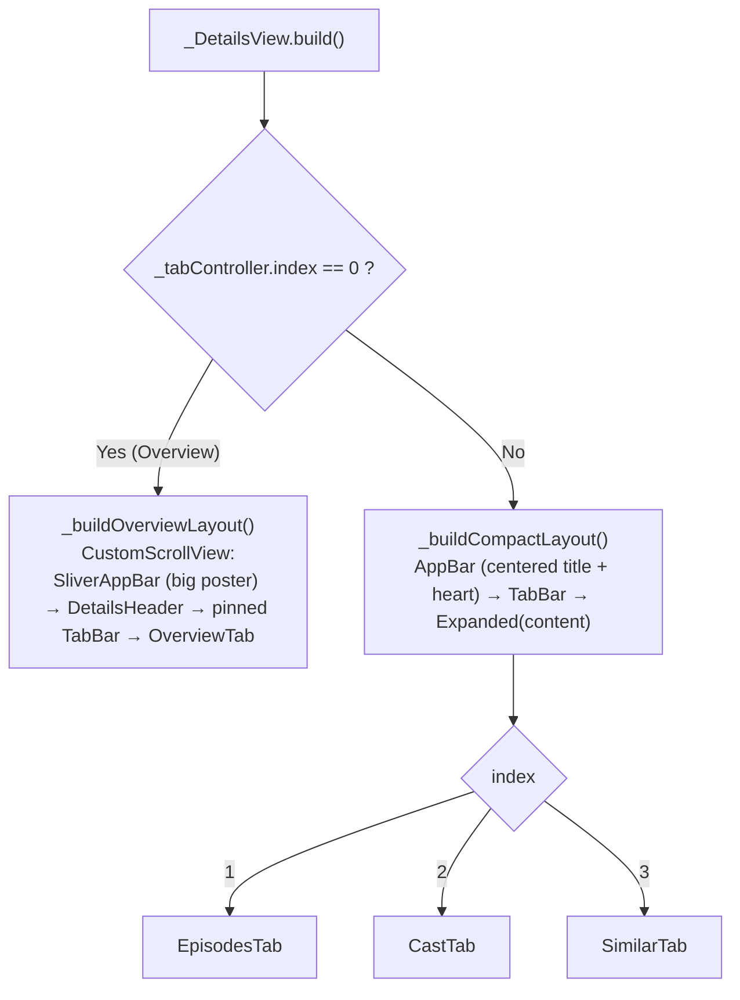

`with SingleTickerProviderStateMixin` gives the `TabController` a **ticker** (a clock) so the
underline can animate.

### 8.6 Details widgets

| Widget | Type | How it works |
|---|---|---|
| `ShowDetailsScreen` | Stateless | `BlocProvider(create: ShowDetailsBloc(repo)..add(LoadShowDetails(id)))` → `BlocBuilder` → loaded? `_DetailsView` : `Scaffold(AppBar + ErrorView/LoadingView)`. `static route(id)` builds the `MaterialPageRoute` so callers write `Navigator.push(context, ShowDetailsScreen.route(id))`. |
| `SliverAppBar` | Flutter | `expandedHeight: 300`, `pinned: true`. `FlexibleSpaceBar.background` = `Stack[PosterImage(original), gradient to background]`. Round back button + `WatchlistIconButton(withBackground: true)`. |
| `DetailsHeader` | Stateless | `Column[name, Wrap[years, "N Seasons", star rating], Wrap[GenreChip...], summary (3 lines), WatchlistButton]` |
| `_TabBarDelegate` | `SliverPersistentHeaderDelegate` | Lets the TabBar **stick** to the top while scrolling (`pinned: true`, min = max = tab bar height). |
| `OverviewTab` | Stateless | **Quick Info** card (`Column` of `_InfoRow`s separated by `Divider`s: Status, Network, Genres, Language; missing value → **"N/A"**) + full summary. It is a `Column`, not a `ListView`, because it sits **inside** a `CustomScrollView`. |
| `EpisodesTab` | Stateless | Empty → EmptyView. Else `Column[DropdownButton<int> (seasons), Expanded(ListView of _EpisodeTile)]`. Dropdown `onChanged` → `add(SeasonSelected)`. |
| `_EpisodeTile` | Stateless | `Row[Stack[PosterImage, number badge], Column[name, date], white play circle]`. Tap → `showModalBottomSheet` with the episode summary. |
| `CastTab` | Stateless | `ListView.separated` of `ListTile(leading: photo, title: actor, subtitle: character, trailing: chevron)`. Tap → bottom sheet with a bigger photo. |
| `SimilarTab` | Stateless | `BlocBuilder<HomeBloc>`: takes the already-loaded home shows, keeps the ones that **share a genre** (`other.genres.any(show.genres.contains)`), removes itself, sorts by rating, takes 20. TVMaze has **no similar API**, so this makes no network call. |
| `WatchlistButton` | Stateless | `BlocBuilder<WatchlistBloc>` → `isSaved`? "In Watchlist" (grey) : "+ Add to Watchlist" (purple). |
| `WatchlistIconButton` | Stateless | Same idea but a heart icon (red when saved). |
| `_toggleWatchlist()` | function | `isSaved ? add(RemoveFromWatchlist) : add(AddToWatchlist)` + SnackBar. |

> **Tip:** The details page **reads two other BLoCs**: `WatchlistBloc` (heart/button) and `HomeBloc`
> (similar shows). They were created in `app.dart`, **above** `MaterialApp`, so every route can
> reach them with `context.read` / `BlocBuilder`.

---

# Lecture 9 — Feature: Watchlist + Local Storage

**Goal:** save/remove shows, and keep them after the app restarts.

### 9.1 How the data is saved

SharedPreferences stores simple key-value data (String, int, bool, `List<String>`).
A `Show` is not a String, so we convert it:

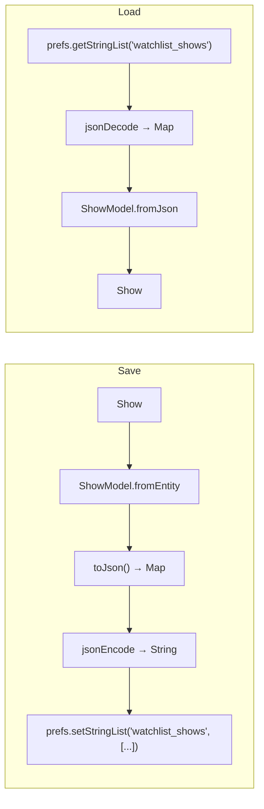

`watchlist_local_data_source.dart`:
```dart
List<ShowModel> getWatchlist() {
  final savedShows = prefs.getStringList(_watchlistKey) ?? [];   // [] if nothing saved yet
  return savedShows.map((text) => ShowModel.fromJson(jsonDecode(text))).toList();
}
Future<void> saveWatchlist(List<ShowModel> shows) async {
  await prefs.setStringList(_watchlistKey, shows.map((s) => jsonEncode(s.toJson())).toList());
}
```

`watchlist_repository_impl.dart` adds the rules:
- `addShow`: **no duplicates** (`any(saved.id == show.id)` → return), new shows go **on top** (`insert(0, ...)`).
- `removeShow`: `removeWhere(id == showId)`, then save.
- `clearWatchlist`: save an empty list.

### 9.2 Events & states

| Event | Fired by |
|---|---|
| `LoadWatchlist` | App start (`app.dart`), Try Again |
| `AddToWatchlist(show)` | Details: button / heart |
| `RemoveFromWatchlist(showId)` | Details: button / heart; Watchlist: heart / ⋮ → Remove |
| `ClearWatchlist` | Watchlist: trash icon → dialog → Clear |

| State | Helpers | UI |
|---|---|---|
| `WatchlistLoading` | — | Spinner |
| `WatchlistLoaded(shows)` | `isInWatchlist(id)` | List, or `EmptyWatchlist` if `shows.isEmpty` |
| `WatchlistError(message)` | — | ErrorView |

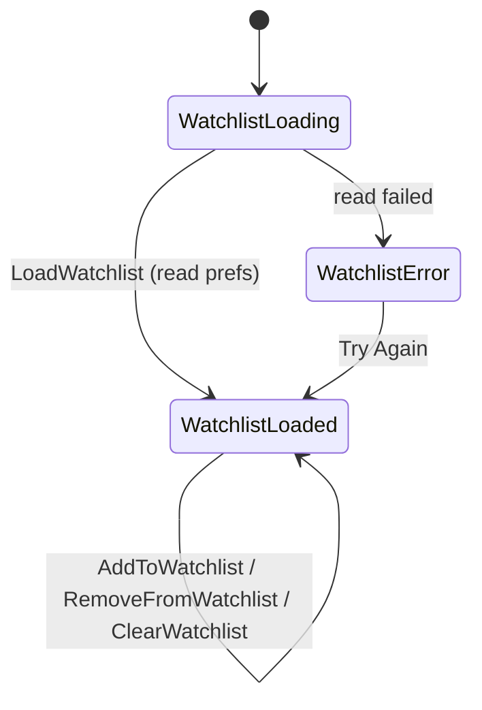

Every change = **save to storage → read the fresh list → `emit(WatchlistLoaded(list))`**.

### 9.3 One BLoC, many screens, always in sync

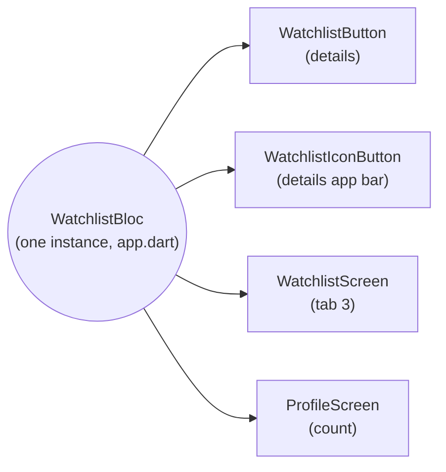
Tap the heart on a details page → the Watchlist tab and the Profile count update **automatically**,
because they all `BlocBuilder` the **same** BLoC.

### 9.4 Watchlist widgets

| Widget | Type | How it works |
|---|---|---|
| `WatchlistScreen` | Stateless | `BlocBuilder` wraps the whole `Scaffold`, so the trash icon appears only when the list has shows. Rows = `ShowListTile` with `trailing: Row[red heart, ⋮ PopupMenuButton]`. |
| `_buildMenu` | method | `PopupMenuButton<String>` with **View details** / **Remove**. |
| `_confirmClear` | method | `showDialog(AlertDialog)` → Cancel / Clear → `add(ClearWatchlist)`. |
| `EmptyWatchlist` | Stateless | Heart icon + box icon + texts + **Explore Shows** button → `onExploreTap` (switches to the Home tab). |

---

# Lecture 10 — Navigation & Profile

### 10.1 `MainScreen` — bottom tabs

```dart
int _currentIndex = 0;
IndexedStack(index: _currentIndex, children: [HomeScreen, SearchScreen, WatchlistScreen, ProfileScreen])
BottomNavigationBar(currentIndex: _currentIndex, onTap: _changeTab, ...)
```
- **`IndexedStack`** builds all 4 tabs but shows only one. The others stay alive, so the **scroll
  position and the search text are kept** when you switch tabs.
- Tabs talk to `MainScreen` through **callbacks**:
  - Home search bar → `onSearchTap: () => _changeTab(1)`
  - Home settings icon → `onSettingsTap: () => _changeTab(3)`
  - Empty watchlist "Explore Shows" → `onExploreTap: () => _changeTab(0)`

### 10.2 Page navigation (push / pop)

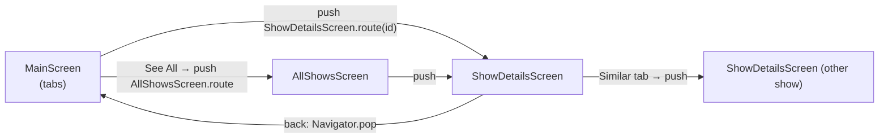
`Navigator` works like a **stack of pages**: `push` adds a page on top, `pop` removes it.

### 10.3 Unknown URLs → 404 page (`app_router.dart`)

On web, opening a URL that doesn't exist (e.g. `localhost:57505/abc`) shows a **404 Page not found**
screen with a **Go to Home** button.

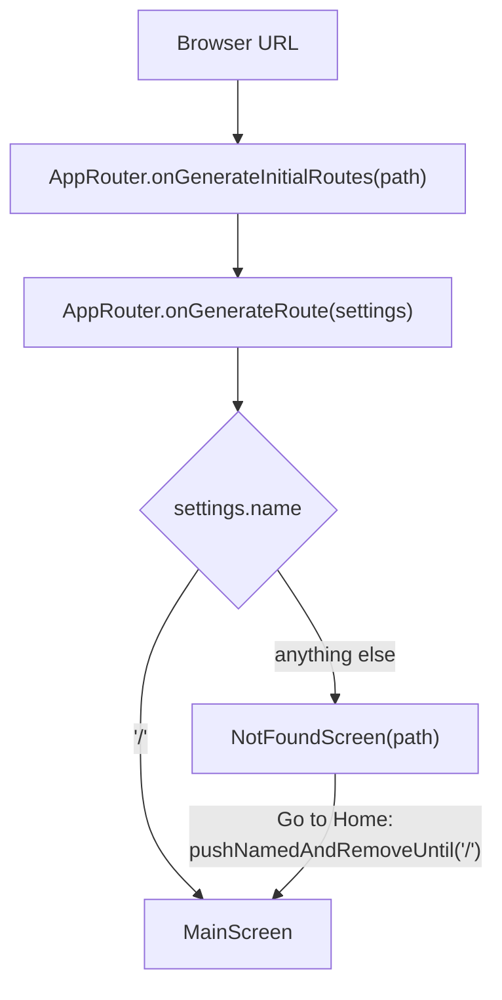

Three pieces make it work:
1. **`usePathUrlStrategy()`** in `main.dart`: Flutter web uses `#` URLs by default (`/#/abc`).
   This switches to normal URLs (`/abc`), so the path reaches the router. It does nothing on Android/iOS.
2. **`onGenerateRoute`**: a `switch` on the route name. `'/'` → `MainScreen`, `default` → `NotFoundScreen`.
3. **`onGenerateInitialRoutes`**: builds the **first** page from the URL. Without it, Flutter
   would silently ignore an unknown starting URL and show Home.

> **Note:** When you host the release build (`flutter build web`), configure the hosting to serve
> `index.html` for every path (the SPA "rewrite" rule). Otherwise the **server** returns its own 404
> before Flutter even loads. `flutter run` already does this for you.

### 10.4 `ProfileScreen`
Simple UI: avatar, name, and 3 `_ProfileTile`s. The first tile uses
`BlocBuilder<WatchlistBloc>` to show the **number of saved shows**.

---

# Lecture 11 — UI Decoded — Widget Trees

### 11.1 Home screen
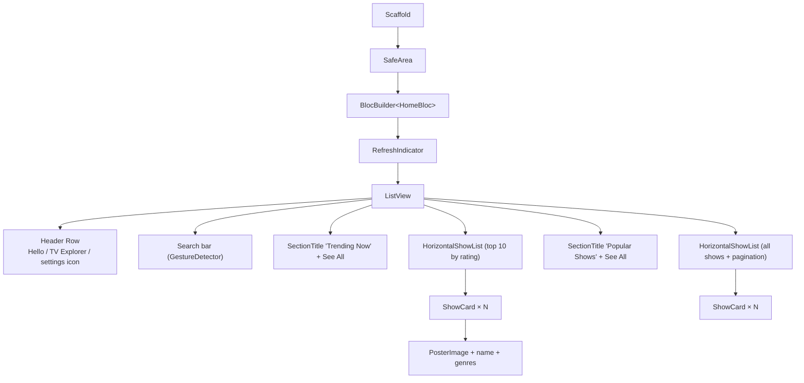

### 11.2 Search screen
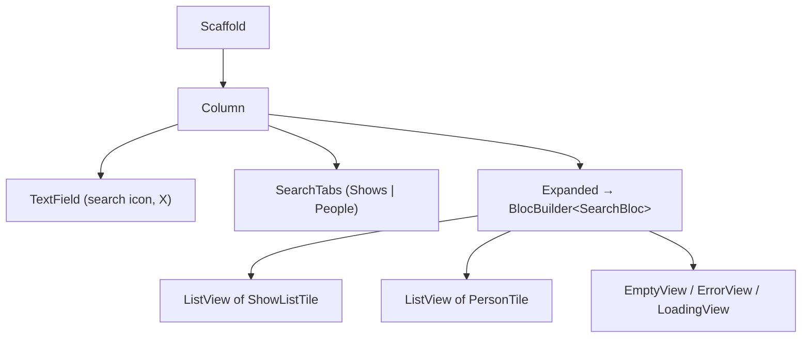

### 11.3 Details screen — Overview layout
```mermaid
graph TD
    S["Scaffold"] --> CSV["CustomScrollView"]
    CSV --> SAB["SliverAppBar (300px, pinned)"]
    SAB --> BK["back button (round)"]
    SAB --> HT["WatchlistIconButton (round)"]
    SAB --> FSB["FlexibleSpaceBar → Stack[PosterImage, gradient]"]
    CSV --> DH["SliverToBoxAdapter → DetailsHeader"]
    DH --> T["title, years · seasons · star rating"]
    DH --> G["Wrap of GenreChip"]
    DH --> SUM["summary (3 lines)"]
    DH --> WB["WatchlistButton"]
    CSV --> TB["SliverPersistentHeader (pinned TabBar)"]
    CSV --> OV["SliverToBoxAdapter → OverviewTab (Quick Info + Summary)"]
```

### 11.4 Details screen — Compact layout (Episodes / Cast / Similar)
```mermaid
graph TD
    S["Scaffold"] --> AB["AppBar (back, centered title, heart)"]
    S --> C["Column"]
    C --> TB["TabBar"]
    C --> E["Expanded"]
    E --> EP["EpisodesTab: Dropdown + ListView of _EpisodeTile"]
    E --> CT["CastTab: ListView of ListTile"]
    E --> SM["SimilarTab: ListView of ShowListTile"]
```

### 11.5 Watchlist screen
```mermaid
graph TD
    BB["BlocBuilder#lt;WatchlistBloc#gt;"] --> S["Scaffold"]
    S --> AB["AppBar 'My Watchlist' + trash icon (if not empty)"]
    S --> B{"state"}
    B -- "empty" --> EW["EmptyWatchlist + Explore Shows"]
    B -- "has shows" --> LV["ListView.separated"]
    LV --> T["ShowListTile + trailing Row[heart, ⋮ menu]"]
```

### 11.6 Common layout widgets used everywhere

| Widget | What it does |
|---|---|
| `Scaffold` | Basic page: `appBar`, `body`, `bottomNavigationBar` |
| `SafeArea` | Avoids the notch / status bar |
| `Column` / `Row` | Vertical / horizontal list of children |
| `Expanded` | "Take all the remaining space" inside a Row/Column |
| `Stack` / `Positioned` | Put widgets **on top** of each other (badge over poster) |
| `Padding` / `SizedBox` | Space around / between widgets |
| `Container` + `BoxDecoration` | Background color, rounded corners, border |
| `ListView.builder` / `.separated` | Scrollable list that builds items **lazily** (only visible ones) |
| `CustomScrollView` + slivers | Advanced scrolling (collapsing app bar, sticky tabs, grids) |
| `GestureDetector` / `InkWell` | Make anything tappable (`InkWell` adds a ripple) |
| `Wrap` | Like a Row, but moves to the next line when full (genre chips) |
| `ClipRRect` | Rounds the corners of its child (posters) |

---

# Lecture 12 — One Full Journey (End to End)

**Story:** the user opens the app → taps *Breaking Bad* → taps **Add to Watchlist** → closes and
reopens the app.

```mermaid
sequenceDiagram
    actor U as User
    participant HS as HomeScreen
    participant HB as HomeBloc
    participant API as TVMaze API
    participant DS as ShowDetailsScreen
    participant DB as ShowDetailsBloc
    participant WB as WatchlistBloc
    participant SP as SharedPreferences

    Note over HB: app.dart: HomeBloc..add(FetchShows)
    HB->>API: GET /shows?page=0
    API-->>HB: JSON → List<ShowModel>
    HB-->>HS: HomeLoaded → posters appear

    U->>HS: tap "Breaking Bad"
    HS->>DS: Navigator.push(route(169))
    DS->>DB: create + add(LoadShowDetails(169))
    DB-->>DS: ShowDetailsLoading
    DB->>API: Future.wait(details, cast, episodes)
    API-->>DB: 3 responses
    DB-->>DS: ShowDetailsLoaded → page drawn

    U->>DS: tap "+ Add to Watchlist"
    DS->>WB: add(AddToWatchlist(show))
    WB->>SP: setStringList([...json])
    WB-->>DS: WatchlistLoaded → button becomes "In Watchlist", heart red

    Note over U,SP: User closes and reopens the app
    WB->>SP: LoadWatchlist → getStringList
    SP-->>WB: saved JSON strings
    WB-->>HS: WatchlistLoaded([Breaking Bad]) still saved
```

**The same 5 steps happen every time:**
1. **UI** → `context.read<XBloc>().add(Event)`
2. **BLoC** handler runs → `emit(Loading)`
3. **Repository → DataSource → ApiClient / prefs**
4. **BLoC** → `emit(Loaded)` or `emit(Error)`
5. **BlocBuilder** redraws

---

# Lecture 13 — Error Handling & Edge Cases

| Situation | Where it's handled | What the user sees |
|---|---|---|
| No internet | `ApiClient` → `ApiException('No internet…')` → BLoC → `XError` | ErrorView + Try Again |
| Server slow (> 15 s) | `ApiClient` `.timeout()` | "Request timed out" |
| Too many requests (429) | `ApiClient` | "Too many requests…" |
| Broken JSON | `ApiClient` `on FormatException` | "Invalid data…" |
| Page doesn't exist (404) during pagination | `HomeRemoteDataSource` → returns `[]` | "You've reached the end" |
| Loading next page fails | `HomeBloc` → `loadMoreFailed: true` | Old shows stay + "Tap to retry" |
| No image | `PosterImage` (`imageUrl == null` / `errorBuilder`) | Icon placeholder |
| No rating | `DetailsHeader` | "N/A" |
| No network / language | `OverviewTab._InfoRow` | "N/A" |
| No summary | `DetailsHeader`, `OverviewTab`, episode sheet | "No summary available." |
| No search results | `SearchBloc` → `SearchEmpty` | "No results found" |
| No episodes / cast | `EpisodesTab` / `CastTab` | EmptyView |
| Same show added twice | `WatchlistRepositoryImpl.addShow` | Ignored |
| HTML in summaries | `TextUtils.stripHtml` | Clean text |
| Unknown error type | `ApiException.messageFrom` | "Something went wrong" |

---

# Lecture 14 — Tests

Run with `flutter test` (127 tests, no internet needed). The `test/` folder mirrors `lib/`:

```
test/
├── helpers/                 shared test tools
│   ├── test_data.dart        sample shows, cast, episodes, API json
│   ├── fake_repositories.dart fake Home/Search/Details/Watchlist repositories
│   └── mock_api.dart         ApiClient with a fake internet (http MockClient)
├── app/app_router_test.dart  "/" → MainScreen, "/abc" → 404 page, bottom tabs
├── core/
│   ├── constants/            endpoint urls + query encoding
│   ├── entities/             Show.yearRange, genresText, equality by id
│   ├── models/               ShowModel fromJson / toJson / fromEntity, webChannel, missing data
│   ├── network/              ApiClient: 200, 404, 429, 500, no internet, broken JSON
│   ├── utils/                stripHtml, formatDate
│   └── widgets/              LoadingView, ErrorView, EmptyView, GenreChip, PosterImage, ShowListTile
└── features/
    ├── home/        data source (404 = end of pages) · HomeBloc (pagination guards) · HomeScreen
    ├── search/      PersonModel + data source · SearchBloc (debounce, tabs) · SearchScreen
    ├── show_details/ Cast/Episode models · ShowDetailsBloc (Future.wait, seasons) · WatchlistButton
    └── watchlist/   repository with real SharedPreferences (restart test) · WatchlistBloc · WatchlistScreen
```

There are three kinds of tests:

| Kind | Tool | Example |
|---|---|---|
| **Unit test** | `test()` | `TextUtils.formatDate('2008-01-20')` → `'Jan 20, 2008'` |
| **BLoC test** | `blocTest()` from `bloc_test` | add `FetchShows` → expect `[HomeLoading, HomeLoaded]` |
| **Widget test** | `testWidgets()` | type "zzzz" in Search → "No results found" appears |

A `blocTest` reads like a sentence:

```dart
blocTest<HomeBloc, HomeState>(
  'emits [Loading, Loaded] with page 0',
  build: () => HomeBloc(repository: repository),   // 1. create the BLoC
  act: (bloc) => bloc.add(const FetchShows()),     // 2. send an event
  expect: () => [                                  // 3. states that must come out
    const HomeLoading(),
    const HomeLoaded(shows: [breakingBad, dark], currentPage: 0),
  ],
);
```

`seed:` starts the BLoC from a chosen state (e.g. already loaded, to test `FetchMoreShows`),
and `wait:` waits for the 500 ms search debounce.

Important tests to mention in the viva:
- **Pagination guard:** `FetchMoreShows` does nothing while loading, after the last page, or before page 0.
- **Debounce:** typing `d`, `da`, `dar`, `dark` fast calls the API **once**, with `dark`.
- **Future.wait:** if only the cast request fails, the whole details page shows the error.
- **Restart:** a new repository reading the same SharedPreferences still finds the saved show.
- **Error handling:** every BLoC turns errors into an Error state with a friendly message.

> **Tip:** This is the **biggest benefit of repositories**: because the BLoC depends on an *abstract*
> `HomeRepository`, a test can pass a fake one.

---

# Lecture 15 — Viva / Exam Q&A

**Q1. What is BLoC?**
Business Logic Component. A class that receives **events**, runs logic (API calls), and outputs
**states**. The UI only sends events and draws states.

**Q2. Difference between Event and State?**
An event is **input** (something happened: `FetchShows`). A state is **output** (what to show:
`HomeLoaded(shows)`).

**Q3. What does `emit` do?**
Sends a new state out of the BLoC. Every `BlocBuilder` listening to it rebuilds.

**Q4. `BlocProvider` vs `BlocBuilder` vs `context.read`?**
`BlocProvider` **creates and provides** the BLoC. `BlocBuilder` **rebuilds UI** when the state
changes. `context.read` **gets** the BLoC once, without listening (used in callbacks to `add` events).

**Q5. Why Equatable?**
So two states with the same values count as **equal**. BLoC skips emitting a state equal to the
current one, and tests can compare states.

**Q6. Where are the API calls? Why not in the widget?**
In the **data sources** (`*_remote_data_source.dart`) through `ApiClient`. The assignment forbids
calling the API in widgets. Separating them makes the code testable, reusable and easy to change.

**Q7. Explain your folder structure.**
Feature-first: each feature has `data` (API, models, repo implementation), `domain` (entities,
repo contracts) and `presentation` (bloc, screens, widgets). Shared code is in `core`.

**Q8. Entity vs Model?**
An entity is plain data used by the app (`Show`). A model **extends** the entity and adds JSON
conversion (`ShowModel.fromJson/toJson`). It belongs to the data layer.

**Q9. What is a Repository and why abstract?**
A repository is the single place a BLoC asks for data. The abstract class (domain) says **what**;
the implementation (data) says **how**. The BLoC depends on the abstract class, so we can swap the
implementation or use a fake one in tests.

**Q10. How does pagination work?**
The scroll listener detects "near the end" → `FetchMoreShows`. The BLoC guards against duplicates
(`isLoadingMore`, `hasReachedEnd`), loads `currentPage + 1`, and appends with
`[...old, ...new]`. TVMaze returns 404 after the last page → `[]` → `hasReachedEnd = true`.

**Q11. How does debounce work?**
A custom `EventTransformer` with rxdart: `debounceTime(500ms)` waits until typing stops for
500 ms, and `switchMap` cancels the previous unfinished search.

**Q12. How are episodes grouped by season?**
`seasons` = unique season numbers (`map → toSet → sort`). `episodesOfSeason(n)` filters with
`where`. Choosing a season fires `SeasonSelected` → `copyWith(selectedSeason)`. No new API call.

**Q13. How is the watchlist saved after restart?**
Each show → `toJson` → `jsonEncode` → String, stored as a `List<String>` in SharedPreferences under
the key `watchlist_shows`. On startup `LoadWatchlist` reads and decodes them.

**Q14. Why is `WatchlistBloc` created in `app.dart` but `ShowDetailsBloc` in the screen?**
The watchlist is shared by many screens for the whole app. Details data belongs to **one** page and
one show, so each details page gets its own BLoC, which is closed automatically when the page closes.

**Q15. How do you handle loading, success, empty and error?**
Each BLoC has a state for each case (`XLoading`, `XLoaded`, `SearchEmpty`/empty list, `XError`).
Each screen's `BlocBuilder` maps them to `LoadingView`, content, `EmptyView`, `ErrorView`.

**Q16. Why `Future.wait` in details?**
It runs the 3 requests **in parallel** (faster), and fails as a whole if any one fails.

**Q17. Why `IndexedStack` for tabs?**
It keeps all tabs alive, so scroll position and search text survive tab switches.

**Q18. What is `copyWith`?**
States are immutable. `copyWith` creates a new state, changing only the given fields.

**Q19. What happens when the image URL is missing?**
`PosterImage` shows a placeholder icon (`imageUrl == null` or `errorBuilder`), so the app never crashes.

**Q20. Why `StatefulWidget` for `SearchScreen` / `HorizontalShowList`?**
They own controllers (`TextEditingController`, `ScrollController`) that must be created once and
disposed in `dispose()`.

**Q21. How does the Similar tab work without an API?**
It reads `HomeBloc`'s loaded shows and keeps the ones sharing at least one genre, sorted by rating.

**Q22. What is dependency injection here?**
Objects get their dependencies **from outside** (constructor), e.g. `HomeBloc(repository: ...)`.
`RepositoryProvider` / `BlocProvider` supply them through the widget tree.

---

# Lecture 16 — Glossary

| Term | Meaning |
|---|---|
| **Widget** | A piece of UI description |
| **Widget tree** | Widgets nested inside each other |
| **BuildContext** | A widget's position in the tree; used to find things above it |
| **setState** | Tell a StatefulWidget to redraw |
| **Future** | A value that arrives later |
| **async / await** | Write waiting code that looks normal and doesn't freeze the app |
| **Stream** | Many values over time |
| **BLoC** | Class: events in → states out |
| **Event** | Input to a BLoC |
| **State** | Output of a BLoC; what the UI shows |
| **emit** | Send a new state |
| **Emitter** | The object handlers use to emit |
| **EventTransformer** | Controls *how* events are processed (debounce here) |
| **Equatable** | Compare objects by values in `props` |
| **Immutable** | Cannot change after creation (`final` fields) |
| **copyWith** | Make a changed copy of an immutable object |
| **Entity** | Pure data class (domain) |
| **Model** | Entity + JSON conversion (data) |
| **Repository** | Single entry point for data; abstract contract + implementation |
| **Data source** | Class that talks to the API or local storage |
| **Dependency injection** | Give objects what they need from outside |
| **JSON** | Text format for data from the API |
| **jsonDecode / jsonEncode** | Text → Map / Map → Text |
| **SharedPreferences** | Small key-value storage on the device |
| **Pagination** | Loading data page by page |
| **Debounce** | Wait for a pause before acting |
| **switchMap** | Cancel the old async work when new work starts |
| **Sliver** | A scrollable piece inside `CustomScrollView` |
| **IndexedStack** | Shows one child, keeps the others alive |
| **Navigator push / pop** | Open / close a page |
| **Cascade `..`** | Call a method and return the same object (`Bloc()..add(e)`) |
| **Spread `...`** | Insert all items of a list into another list |
| **`?.` / `??`** | Null-safe access / default value if null |

---

<p align="center">Built with Flutter + BLoC · Data from <a href="https://www.tvmaze.com/api">TVMaze API</a></p>
